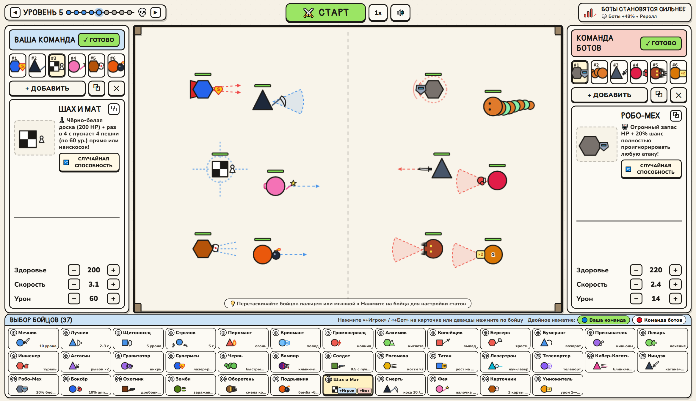
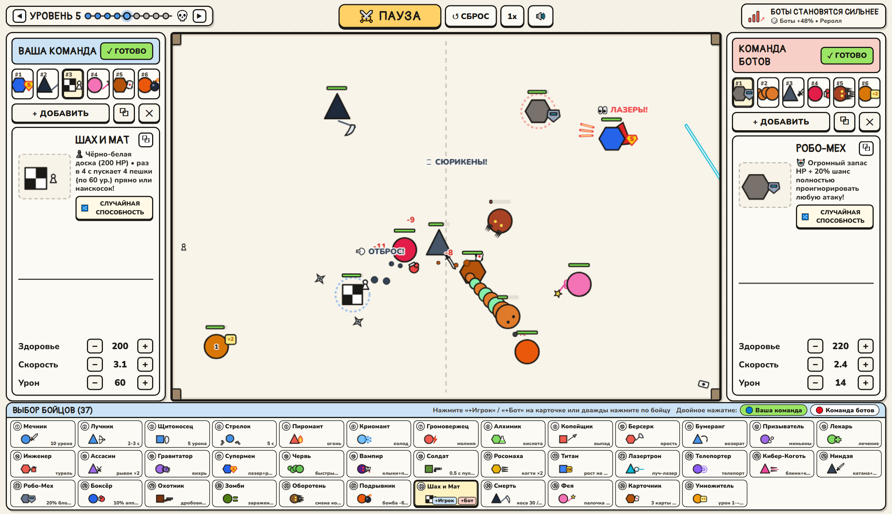
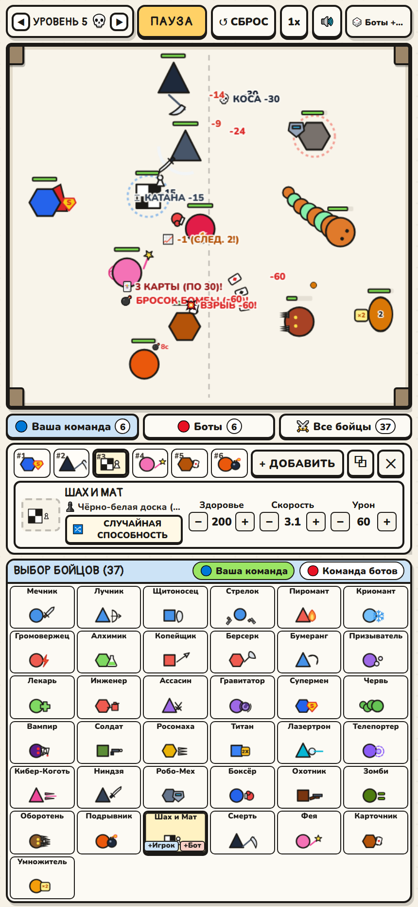

# ⚔️ Battle Royal Paper — Бумажная Арена (PaperArena)

2D тактический авто-баттлер на ринге с видом сверху в рисованном «бумажном» стиле:
- **37 уникальных бойцов** с собственным оружием и суперспособностями (Мечник, Лучник, Щитоносец, Стрелок, Супермен, Червь, Вампир, Солдат, Ниндзя, Робо-Мех, Боксёр, Охотник, Зомби, Оборотень, Подрывник, Шах и Мат, Смерть, Фея, Карточник, Умножитель и другие).
- **Свободная настройка команд**: меняйте здоровье, скорость, урон, выдавайте случайные способности и расставляйте бойцов на ринге.
- **Финальное ускорение**: когда на арене остаётся мало бойцов, они увеличиваются в размерах и ускоряются!
- **Полная адаптация под ПК и мобильные телефоны** без полос прокрутки.

## 📸 Скриншоты





## 🚀 Как запустить

Достаточно открыть `index.html` в браузере или запустить локальный сервер:
```bash
npx serve .
```
